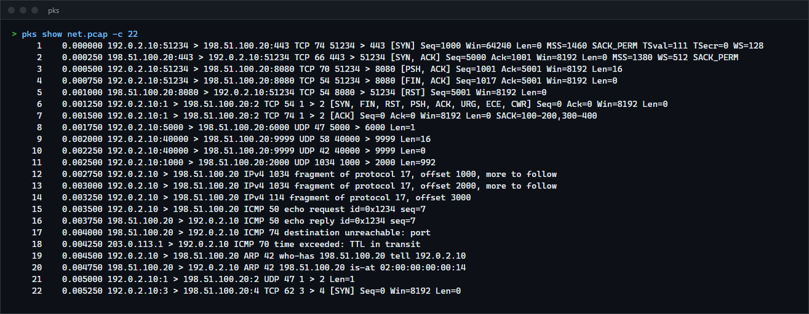
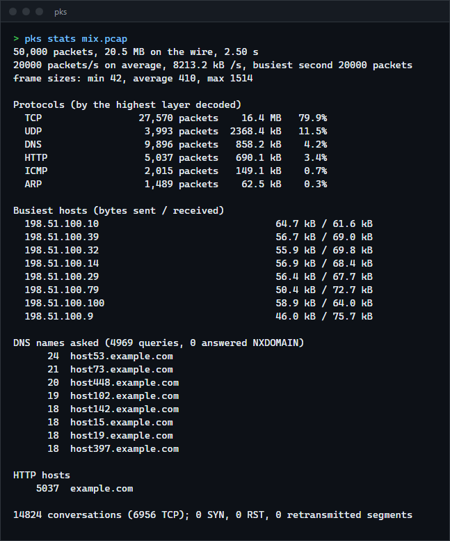
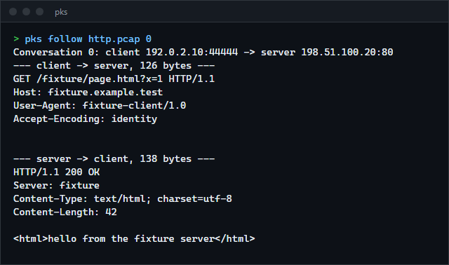
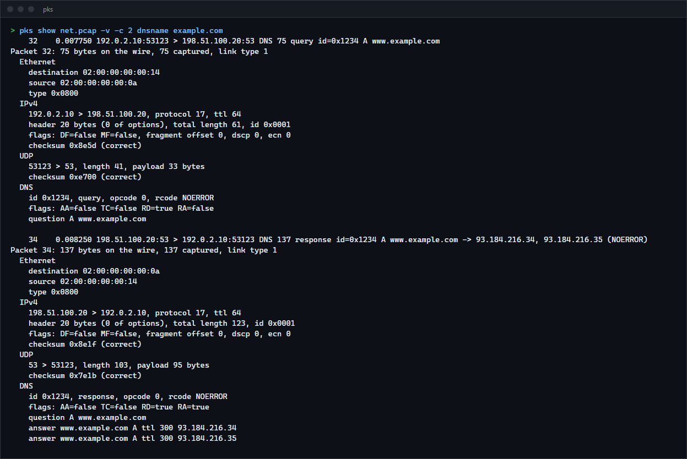

# pktscope

A packet analyzer for pcap and pcapng files that reads Ethernet, VLAN, ARP, IPv4, IPv6, ICMP, TCP, UDP, DNS, HTTP, TLS and DHCP, filters with a tcpdump-style language, summarises a capture, lists its conversations and reassembles TCP streams. On Windows it can also record a capture itself with no driver to install. For anyone who wants to see what a capture contains from the command line, or to read how a packet decoder is built.

**Status:** v0.1.0, working on Windows. The Linux build is compile-checked only. Live capture is Windows only. Not published to crates.io.



## Features

- **Capture files:** classic pcap (microsecond and nanosecond timestamps, both byte orders) and pcapng (several sections, several interfaces, per-interface timestamp resolution, interface names). Ethernet, raw IP, loopback and Linux cooked captures.
- **Decoding:** VLAN stacks, ARP, IPv4 with options and fragments, IPv6 with extension headers and fragments, ICMPv4 and ICMPv6, TCP with every common option, UDP, and by looking at the bytes (not the port) DNS (with name compression, also over TCP and mDNS), HTTP/1.x, TLS (ClientHello server name, ALPN, offered and negotiated versions, ServerHello cipher) and DHCP.
- **Checksums** of IPv4, TCP, UDP and ICMP are verified and reported, never trusted silently.
- **Filters** such as `tcp and port 443`, `not arp`, `net 10.0.0.0/8`, `len > 1000`, `dnsname example.com`, `sni example.com`, `contains "password"`.
- **Reports:** `stats` (protocols, busiest hosts, DNS names, TLS server names, HTTP hosts), `flows` (conversations with state and retransmissions), `dns` (queries paired with answers and latency).
- **TCP stream reassembly** (`follow`): out-of-order segments, retransmissions, overlaps with a conflict count, gaps with their size, sequence numbers that wrap.
- **Output as text, a verbose layer dump, a hex dump or JSON** (one object per packet, for `jq`), and `extract` to write the matching packets to a new pcap.
- **`capture`** (Windows): records with the `pktmon` tool that ships with Windows and converts to pcapng.

## How to install

Requires a recent stable Rust (built and tested with 1.98.1).

```sh
git clone https://github.com/r3clusionn/packet-analyzer
cd packet-analyzer
cargo install --path .
```

This installs the `pks` command. Reading captures needs nothing else; `pks capture` needs Windows 10 or later and an elevated terminal.

## How to use

```sh
pks capture lan.pcapng --seconds 10 --port 53        # record 10 s of DNS (elevated terminal)
pks show lan.pcapng                                  # one line per packet
pks show lan.pcapng tcp and port 443 -c 20           # filter, first 20 matches
pks show lan.pcapng -v -x dnsname example.com        # every layer and a hex dump
pks stats lan.pcapng                                 # what is in this capture
pks flows lan.pcapng                                 # conversations, numbered
pks follow lan.pcapng 3                              # the data of conversation 3
pks dns lan.pcapng                                   # queries, answers, response times
pks extract lan.pcapng web.pcap tcp and port 80      # keep only matching packets
```

| Command | What it does |
|---|---|
| `show FILE [FILTER]` | Summary lines. `-c N` stops after N packets, `-v` describes every layer, `-x` adds a hex dump, `--json` prints one JSON object per packet, `-t rel\|delta\|abs\|epoch` chooses the time column, `--checksums` marks wrong checksums. |
| `stats FILE [FILTER]` | Packet and byte totals, rates, protocol breakdown, busiest hosts, DNS names, TLS server names, HTTP hosts. `--json` for the data. |
| `flows FILE [FILTER]` | One row per conversation: client, server, packets, bytes, duration, TCP state, retransmissions. The row's number is what `follow` takes. |
| `follow FILE N` | The reassembled data of TCP conversation N, in the order it arrived. `--hex`, `--direction c2s\|s2c`, and `--raw` (with a direction) to write the bytes unchanged, for example to save a downloaded file. |
| `dns FILE` | Each DNS query with its answers and the time to the response; queries with no response are listed as such. |
| `extract FILE OUT [FILTER]` | Write the matching packets to a new pcap file. |
| `capture OUT` | Record with pktmon: `--seconds N` (or Enter/Ctrl+C), `--port N`, `--ip ADDR`, `--proto tcp\|udp\|icmp\|arp`, `--snaplen BYTES`, `--nics-only`. |
| `--dedup` (most commands) | Skip copies of a packet recorded more than once. A pktmon capture records each packet at every layer of the network stack; on this machine every packet appeared five times. |

Everything after the file name is the filter, so `pks show cap.pcap tcp and port 80` works without quotes; options go before it.

| Filter term | Meaning |
|---|---|
| `ip ip6 tcp udp icmp icmp6 arp dns http tls dhcp` | the packet has this layer |
| `[src\|dst] host ADDR`, `[src\|dst] net ADDR/BITS` | IPv4 or IPv6 address, or prefix |
| `[src\|dst] port N`, `[src\|dst] portrange A-B` | TCP or UDP port |
| `len OP N` | frame length, `OP` is `< <= = != >= >` |
| `syn fin rst psh ack urg` | TCP flag set |
| `frag`, `vlan [ID]`, `iface N` | fragments, VLAN tag, capture interface |
| `dnsname T`, `sni T`, `httphost T`, `contains T` | case-insensitive substring in a DNS name, a TLS server name, the HTTP Host header, the payload |

Terms combine with `and`/`&&`, `or`/`||`, `not`/`!` and parentheses; `not` binds tightest, then `and`, then `or`. Quote a phrase: `contains "hello world"`.







## How it works

- **Decoding is a walk down the layers** (`decode.rs`). Each layer reads its header through a cursor that cannot read past the end; when a header does not fit in the captured bytes the layers decoded so far are kept and the decoder says which header was cut. The IP total length, not the frame length, ends the IP payload, so Ethernet padding is never mistaken for TCP data.
- **Applications are recognised by content.** A payload is HTTP when it starts with a method and ends its first line with `HTTP/1.x`; TLS when the record header is plausible; DHCP when the magic cookie is there. Port numbers are only used for DNS, where the TCP form needs the length prefix.
- **DNS names are bounded** (`dns.rs`): at most 255 bytes of name and 64 compression pointer jumps, every label and pointer checked against the message. A pointer to itself, two pointers pointing at each other and a name that never ends all end in an error, and a message that claims a huge number of records is refused.
- **Reassembly** (`stream.rs`) unwraps 32-bit sequence numbers into 64-bit offsets (so a stream may cross the wrap more than once), parks segments that arrive ahead of a gap, delivers them when the gap fills, and when two segments overlap with different bytes keeps the first and counts the conflict. Chunks are emitted in the order the data became contiguous, as Wireshark's Follow TCP Stream shows it.
- **The CLI never builds a list of packets.** Every command streams the file, so a capture larger than memory works; `follow` reads the file twice.

## Benchmarks

On an Intel Core i9-14900KF, Windows 11, Rust 1.98.1: 1,000,000 generated packets (405 MB; 55% TCP data, 10% HTTP, 20% DNS, 8% UDP, 4% ICMP, 3% ARP over about 4,000 flows, `examples/gen_capture.rs`), the file in the operating system's cache, output to the null device, median of 5 runs, each including process start.

| Command | Time | Packets per second | Of the file |
|---|---|---|---|
| `show` (one summary line each) | 2.52 s | 397,000 | 161 MB/s |
| `show --json` (every field of every layer) | 3.11 s | 321,000 | 130 MB/s |
| `show tcp and port 443` | 1.64 s | 608,000 | 246 MB/s |
| `show dnsname host7.example.com` | 0.60 s | 1,675,000 | 679 MB/s |
| `stats` | 1.08 s | 925,000 | 375 MB/s |
| `flows` | 0.90 s | 1,114,000 | 451 MB/s |

For scale, on the first 100,000 packets of the same file: `pks show` takes 0.23 s; scapy 2.8 in Python needs about 13 s to read the file and write a summary line for each packet (7,000 to 8,000 packets per second, three runs). Scapy decodes more protocols and decodes lazily, so this is a scale, not a verdict.

## Verification

- `cargo test --release` runs 88 unit tests, 9 tests of the command line, 6 comparisons with other implementations and 2 fuzz tests.
- **Against scapy.** `scripts/make_fixtures.py` builds 43 frames with scapy (TCP with every option, fragments, IP options, VLAN and QinQ, IPv6 with hop-by-hop, destination, fragment headers, ICMP and ICMPv6, ARP, DNS including a hand-compressed response, DNS over TCP, mDNS, DHCP). The expected values are what scapy reports when it parses the finished bytes again, so they come from a second implementation. All 43 frames decode to the same addresses, ports, sequence numbers, flags, options, lengths, DNS names and answers.
- **On real traffic.** `scripts/compare_scapy.py` does the same comparison for any capture. On a 260-packet capture of this machine's own traffic made with `pks capture` and `pktmon` (IPv6 DNS, HTTP, TLS, ICMP, ARP, SSDP; not committed, it holds private addresses), all 260 packets agree.
- **Real TLS.** Two handshakes (TLS 1.2 with ECDHE-RSA and TLS 1.3) between two OpenSSL endpoints, carried over TCP and reassembled: the server name, the ALPN offer, the negotiated version and the cipher suite equal what the `ssl` objects report, and the reassembled streams are byte for byte the flights the endpoints produced. Python's own `http.server` and `http.client` supply an HTTP exchange the same way.
- **Reordering.** The TLS 1.3 capture was shuffled and partly duplicated 50 times; the reassembled streams never changed.
- **Fuzzing.** 7,500 mutated capture files (bit flips, deleted and inserted bytes, truncation, anywhere including the file and record headers) go through the reader, decoder, filters, every formatter, flow table, statistics, DNS pairing and the reassembler without a panic.
- **Mutation checks**, each confirmed to fail a test when the code is broken: checksum arithmetic for odd lengths, IPv6 extension and Authentication Header lengths, the IPv4 and UDP length trimming, sequence number unwrapping, first-copy-wins on conflicting overlaps, the DNS pointer bound, `and`/`or` precedence, ignoring TLS GREASE values, the duplicate window and the HTTP start line limit. One mutant survives, changing `end <= next` to `end < next` in the retransmission test; I did not investigate whether it is equivalent.
- The comparisons found real things: the first DNS fixture had a record length I had miscounted, which `pks` reported as a malformed record, and the pktmon capture showed that every packet is recorded five times, which led to `--dedup`.

## Limits

- IP fragments are listed but not reassembled, so the contents of a fragmented datagram beyond its first fragment are not decoded.
- No TLS decryption, no HTTP/2 or HTTP/3, no QUIC, no SSH or other protocols beyond the list above. Application protocols are decoded from the packet that carries their start; a DNS or TLS message split across segments is shown as far as it goes.
- In reassembly, the first segment seen on one side of a connection (the SYN, when the capture has it) starts that side's stream. Bytes that arrive later but belong before it count as retransmissions and are dropped.
- `--dedup` assumes identical bytes within a millisecond are copies of one packet. Two genuinely identical packets that close together are dropped too.
- The capture checksum markers are off by default: a capture taken on the sending machine usually has checksums the network card has not filled in yet.
- `capture` needs Windows, an elevated terminal and `pktmon`; on other systems record with `tcpdump` or Wireshark and read the file with `pks`. Only Windows was run.

## License

MIT (see `LICENSE`).
